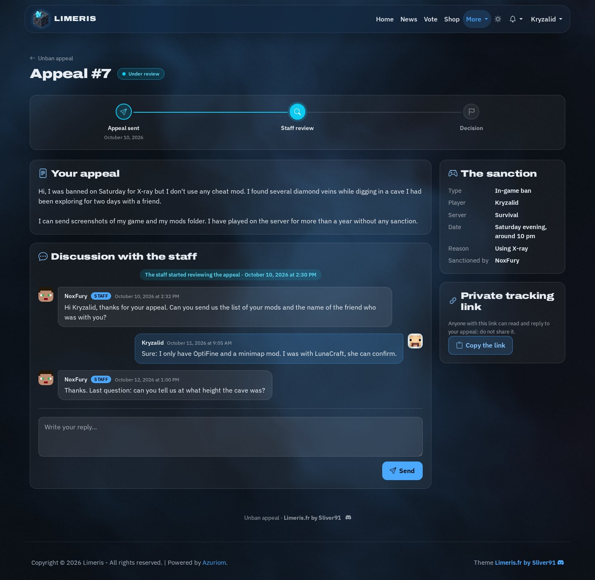
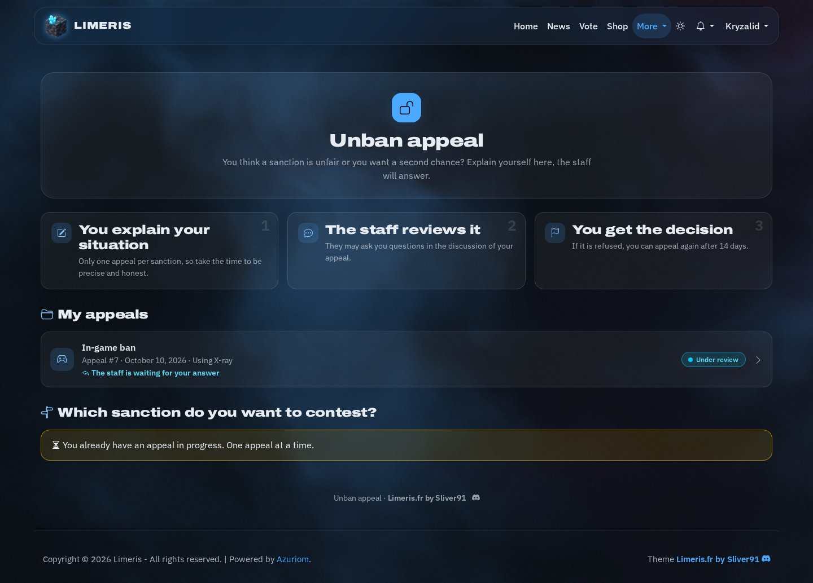
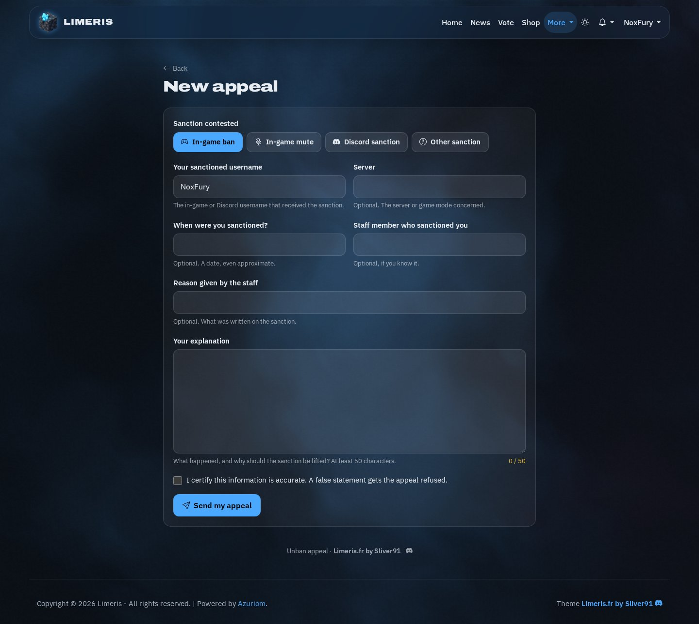
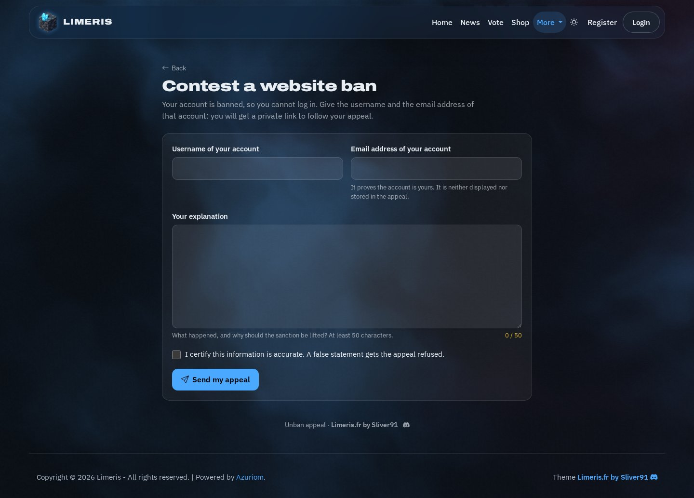
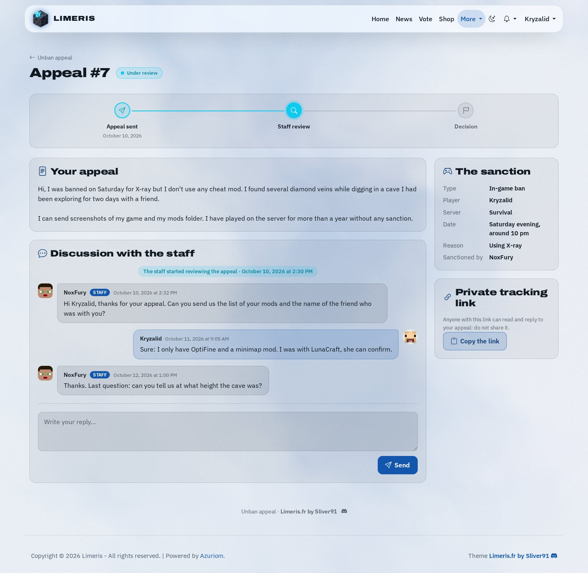
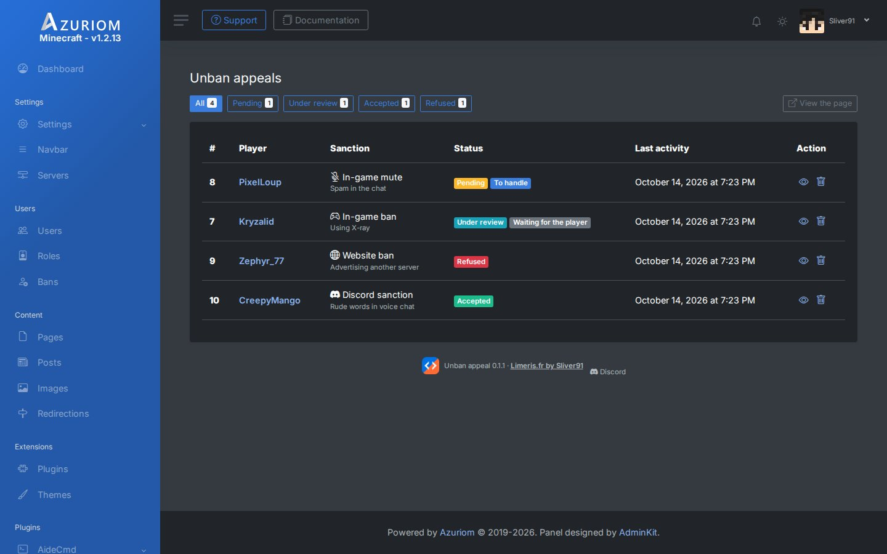
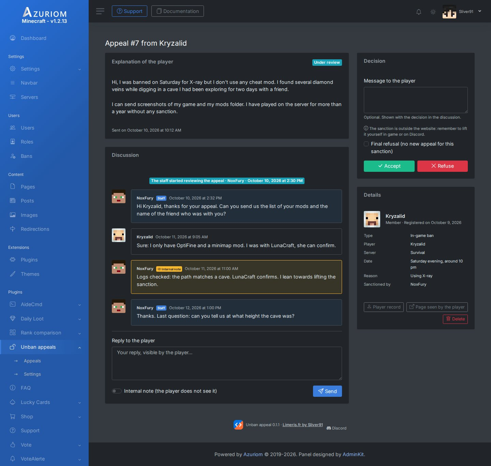
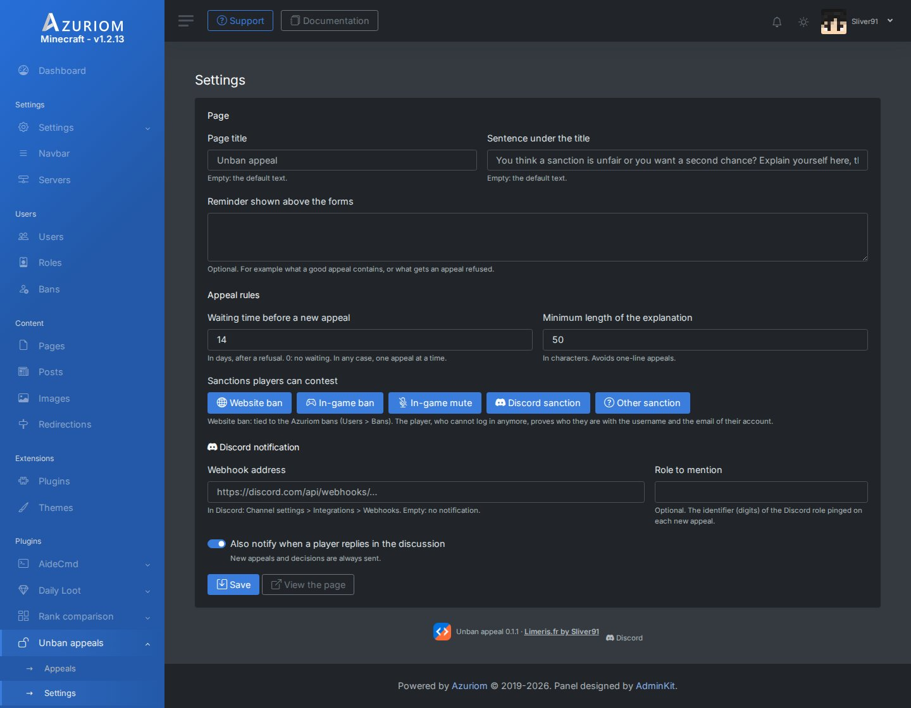
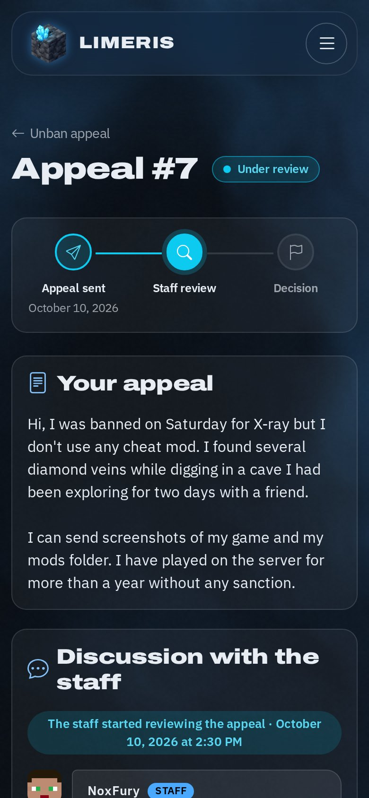

# Unban Appeal (Demande de débannissement)

[Read in English](README.md) · **Limeris.fr by Sliver91** · [limeris.fr](https://limeris.fr) · [Discord](https://discord.gg/4kV8pgC3Ck)

Plugin [Azuriom](https://azuriom.com) : un formulaire de contestation relié à la sanction du joueur, avec un fil de discussion entre le joueur et le staff. Fonctionne pour tous les jeux (Minecraft, FiveM, Rust, Garry's Mod…).

> **Vitrine uniquement.** Ce dépôt présente le plugin : il ne contient pas ses fichiers. **Prochainement disponible** sur le Market Azuriom. Suis les nouveautés sur [Discord](https://discord.gg/4kV8pgC3Ck).

## Captures

Les captures sont en anglais ; le plugin est livré en français et en anglais.

| | |
|---|---|
|  **Accueil** : fonctionnement, tes demandes |  **Nouvelle demande** (sanction en jeu ou Discord) |
|  **Bannissement du site** : demande sans connexion |  **Mode clair**, suit le thème installé |
|  **Admin : liste des demandes** |  **Admin : une demande**, notes internes et décision |
|  **Admin : réglages** |  **Sur téléphone** |

Captures réalisées avec le thème gratuit Haze Limeris.

## Ce que voit le joueur

- **Deux parcours**, selon la sanction :
  - **Bannissement du site** : le joueur ne peut plus se connecter. Il fait sa demande avec le pseudo et l'adresse e-mail de son compte, et la demande est reliée automatiquement à son bannissement.
  - **Sanction en jeu ou sur Discord** (bannissement, mute, autre) : le joueur est connecté et décrit sa sanction.
- **Une demande par sanction**, et une seule demande à la fois.
- **Un fil de discussion** avec le staff, sur la page de sa demande.
- **L'avancement** en trois étapes : demande envoyée, examen par le staff, décision.
- **Un lien privé de suivi**, à garder : il permet de suivre la demande sans être connecté.
- **Un délai avant une nouvelle demande** après un refus, affiché avec la date.

La page reprend la police, les couleurs et le mode clair ou sombre du thème installé, quel qu'il soit.

## Ce que voit le staff

- La liste des demandes, filtrée par état, avec celles qui attendent une réponse en tête.
- Pour chaque demande : l'explication du joueur, la sanction, le fil de discussion et les autres demandes du même joueur.
- **Réponse au joueur** ou **note interne** que le joueur ne voit jamais.
- **Accepter** ou **refuser**, avec un message. Accepter peut lever le bannissement du site en même temps. Un refus peut être définitif.
- **Notification Discord** à chaque nouvelle demande, réponse d'un joueur et décision.

## Prérequis

- Azuriom 1.2 ou plus récent.
- Aucun autre plugin n'est nécessaire.

## Configuration

Tout se trouve dans **Débannissement > Réglages**.

### Page

- **Titre de la page** et **phrase sous le titre**.
- **Rappel affiché au-dessus des formulaires** : facultatif. Par exemple ce qu'une bonne demande doit contenir, ou ce qui entraîne un refus.

### Règles des demandes

- **Délai avant une nouvelle demande** : en jours, après un refus (14 par défaut). 0 : pas de délai. Dans tous les cas, une seule demande à la fois.
- **Longueur minimale de l'explication** : en caractères (50 par défaut), pour éviter les demandes d'une ligne.
- **Sanctions que les joueurs peuvent contester** : bannissement du site, bannissement en jeu, mute en jeu, sanction sur Discord, autre sanction. Décoche celles que tu ne veux pas proposer.

### Notification Discord

1. Dans Discord, ouvre **Paramètres du salon > Intégrations > Webhooks**, crée un webhook et copie son adresse.
2. Colle-la dans **Adresse du webhook**.
3. Facultatif : indique l'identifiant du **rôle à mentionner** à chaque nouvelle demande (clic droit sur le rôle > Copier l'identifiant, avec le mode développeur de Discord activé).
4. Choisis si les réponses des joueurs dans le fil sont envoyées aussi. Les nouvelles demandes et les décisions le sont toujours.

## Traiter une demande

Ouvre **Débannissement > Demandes**, puis une demande.

1. **Passer en examen** indique au joueur que sa demande est lue. Répondre au joueur le fait automatiquement.
2. **Répondre** dans le fil pour poser une question. Active **Note interne** pour laisser un mot au reste du staff, invisible pour le joueur.
3. **Accepter** ou **Refuser**, avec un message facultatif affiché au joueur.
   - Pour un bannissement du site, la case **Lever le bannissement du site en acceptant** s'en charge.
   - Pour une sanction en jeu ou sur Discord, lève-la toi-même là où elle a été donnée.
   - **Refus définitif** empêche toute nouvelle demande pour cette sanction.
4. **Rouvrir la demande** annule une décision.

Le joueur connecté reçoit une notification sur le site à chaque réponse et à la décision.

## Le bannissement du site, en détail

Ce parcours utilise les bannissements d'Azuriom (**Utilisateurs > Bannissements**). Un compte banni ne peut plus se connecter, donc :

- le joueur prouve que le compte est le sien avec son pseudo et son adresse e-mail. L'e-mail n'est ni affiché ni enregistré dans la demande ;
- le message d'erreur est le même que le pseudo, l'e-mail ou le bannissement soit en cause, pour ne rien révéler sur les comptes ;
- le nombre d'essais est limité ;
- la page de suivi est atteinte par un lien secret, que le joueur doit garder. Elle n'est pas référencée par les moteurs de recherche.

## Qui peut gérer le plugin

Les administrateurs, et tout rôle auquel tu donnes la permission **Traiter les demandes de débannissement** dans **Utilisateurs > Rôles**.

## Aide

Une question, un bug, une idée : rejoins le [Discord](https://discord.gg/4kV8pgC3Ck).

---

Demande de débannissement · **Limeris.fr by Sliver91**
